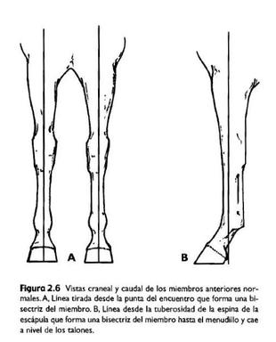
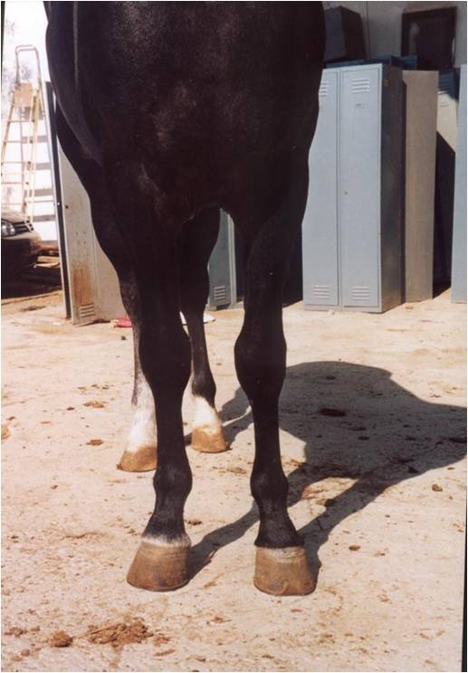
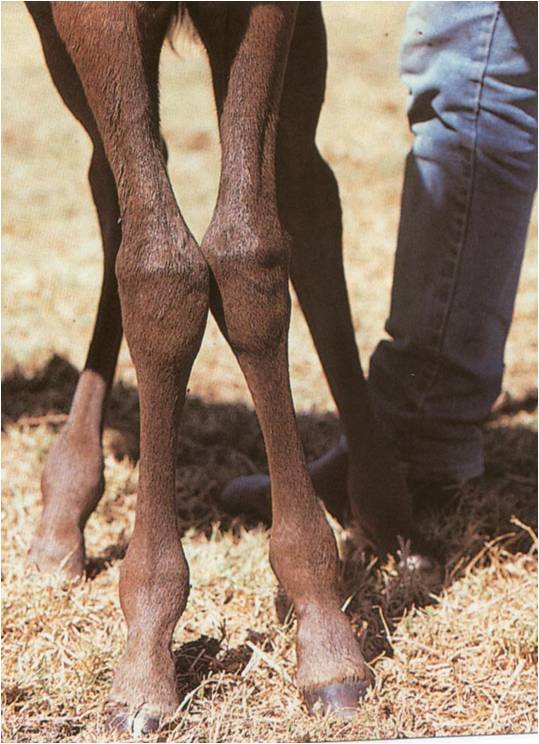
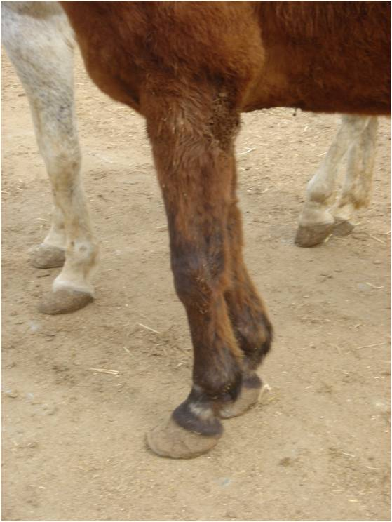
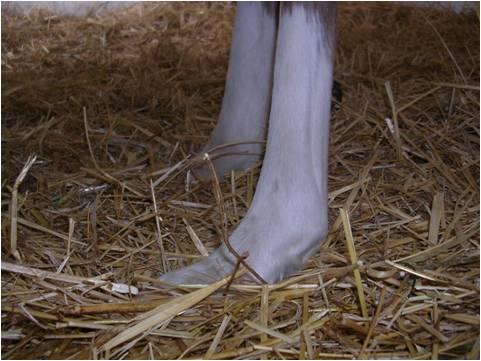
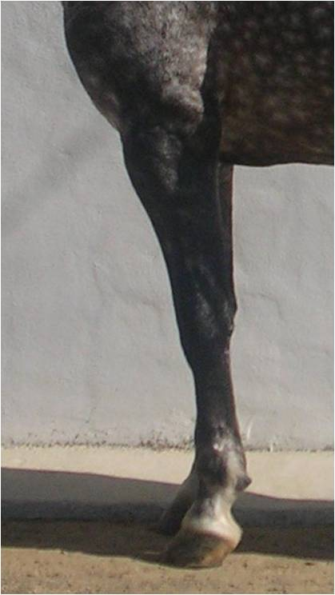
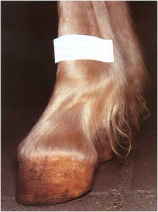

## ¿Qué son los aplomos?

Es la forma que tiene el animal de colocar sus miembros o patas en el suelo. Unos malos aplomos predisponen a debilidad, problemas de carga (cojeras) e interferencia de miembros (alcances). Para poder detectar problemas de aplomos en un caballo no solo hay que observar al caballo parado, si no tambien en movimiento. En ambos casos habra que mirar desde en lateral, delante y detrás. En movimiento hay que verlo en suelo duro y cómo es el movimiento al inicio del tranco, durante la fase de vuelo y cuando apoya.

Son pocos los animales que poseen unas extremidades con una forma perfecta; la mayoría de ellos tienen defectos de poca consideración que solo rebajarían su puntuación en la pista de exhibición, pero que no afectan para nada a su constitución atlética.

## Miembros anteriores

Primero nos posicionaremos de frente al caballo, unos buenos aplomos de los miembros anteriores (manos) deben de ser asi:

- Miembros derechos y llevando el mismo peso.
- Si se traza una linea desde el encuentro lo divide a la mitad
- Pies con la misma separación que pecho
- Carpos centrados, sin desviar hacia los laterales

Cuando nos colocamos desde el lado hay que observar lo siguiente:

- Si se traza una línea perpenticular al suelo desde en codo ésta dividirá la mano en dos hasta el menudillo y terminará en los talones.
- Eje podofalángico: Hace 45-50º con el suelo.
- Carpo bien alineado con el resto de la mano: Importante porque debe soportar la flexión, extensión y concusión del miembro.

## Miembros anteriores: defectos de aplomo

Si nos situamos de frente al caballo estos serian los defectos que podemos encontrar:

- **Cerrado de manos:** La distancia entre los cascos es menos que entre el pecho. En movimiento aterrizan primero con la parte externa del casco.
- **Abierto de manos:** Distancia entre los cascos es mayor que la distancia entre el pecho. Aterrizan primero con la parte interna del casco.
- **Estevado:** Los pies apuntan uno hacia el otro. Tienden al campaneo.
- **Izquierdo:** Los pies divergen. Tienen problemas de interferencia de miembros.
- **Valgus carpiano:** Carpo desviado medialmente, como consecuencia la caña, el menudillo y la cuartilla giran hacia fuera.
- **Varus carpiano:** Carpo desviado lateralmente, la caña, el menudillo y la cuartilla giran hacia dentro (generalmente estevados y cerrados de manos)

Si nos situamos desde el lateral y miramos el caballo de perfil, estos son los defectos que podemos encontrar:

- **Transcorvo:** Desviación hacia atrás del carpo. Conformación débil porque hay mucha tensión sobre el carpo y las estructuras tendinosas.
- **Corvo:** Desviación hacia delante del carpo. Provocado generalmente por retracción de los músculos flexores.
- **Remetido de manos:** Toda la extremidad está desplazada por detrás de la perpenticular. Disminuye la base de sustentación.
- **Plantado de delante:** La extremidad está desplazada por delante de la perpenticular.
- **Topino:** La cuartilla se sitúa muy vertical. Aumenta la concusión y hay gran tensión sobre el navicular. Producido por retracción de los tendones flexores.
- **Pando:** El ángulo de la cuartilla con el suelo es menos de 45º. Por laxitud de los tendones flexores.

