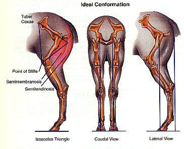
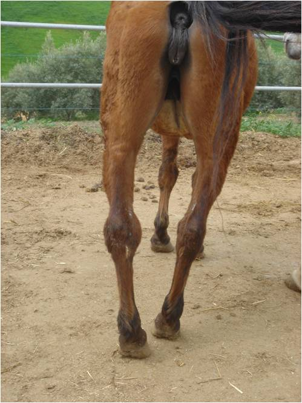
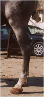
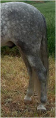
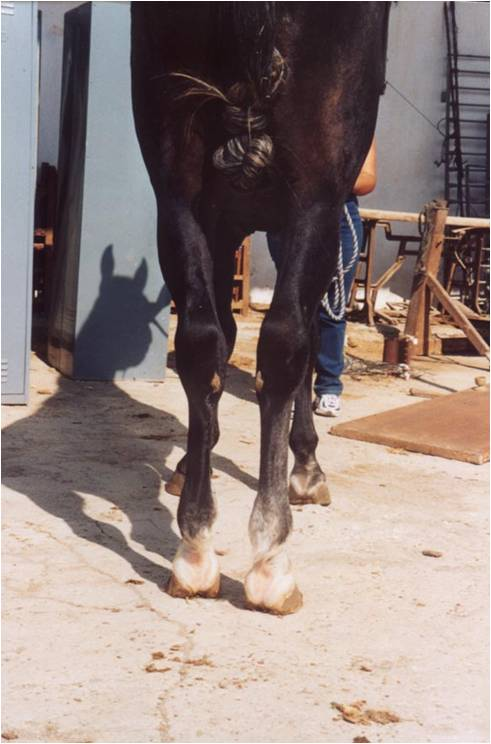

## Miembros posteriores

Para evaluar los aplomos de los miembros posteriores debemos situarnos primero en la parte trasera del caballo. Debemos observar:

Apariencia equilibrada y buena musculatura. Si se traza una línea desde la tuberosidad isquiática divide el miembro en partes iguales.

Una vez visto desde atrás, debemos posicionarnos en un lateral y observar lo siguiente:

Ni excesivamente ni muy poco angulado. Si se traza una línea desde la tuberosidad isquiática, ésta pasará por el tarso y desciende por la cara posterior de la caña para terminar por detrás del talón.

## Miembros posteriores: defectos de aplomo

Desde una vista caudal (desde atrás) estos son los defectos de aplomo que podríamos encontrar:

- **Cerrado de atrás:** La distancia entre los pies es menor que la distancia entre las tuberosidades isquiáticas.
- **Abierto de atrás:** La distancia entre los pies es mayor que la distancia entre las tuberosidades isquiáticas. Muy poco frecuente.
- **Cerrado de corvejones (Valgus tarsiano):** Desviación hacia adentro de los corvejones. Desde arriba hasta el corvejón sería cerrado de atrás y de corvejón hacia abajo abierto. Todos son quebrados de corvejones. Tienen predisposición al esparaván.

Una vez evaluado desde una vista posterior nos situaremos en uno de los lados. Estos son los defectos que podemos encontrar:

- **Quebrado de corvejones:** Disminuye la angulación del tarso. La caña no sería paralela a la línea que parte de la tuberosidad isquiática paralela al suelo. Sería remetido de corvejón hacia abajo.
- **Remetido de atrás:** El miembro se desplaza hacia delante y queda por debajo de la masa del cuerpo.
- **Plantado de atrás:** El miembro se desplaza por detrás de la línea que se traza desde la tuberosidad isquiática. Se asocia a cuartillas muy verticales.

Los defectos que se observan por debajo del menudillo (pando-topino y estevado-izquierdo) se evaluaran siguiendo los mismos criterios que en los miembros anteriores.

