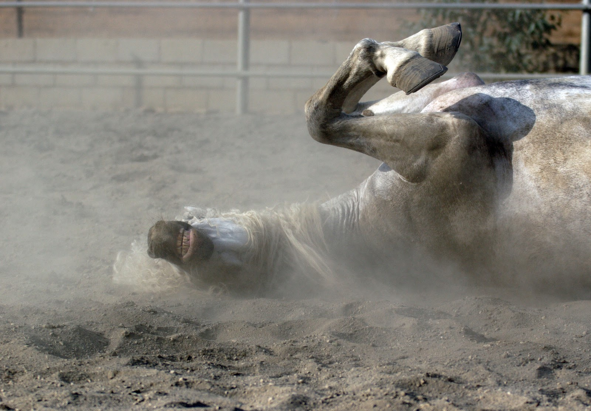
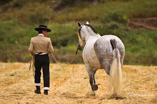

Una mañana llegamos a la cuadra y nos encontramos a un caballo que escarba, se revuelca y no quiere comer... ¿qué hacemos ahora? Lo primero y más importante es conservar la calma. Hay que recordar los síntomas de los cólicos e identificar si es un cólico u otro tipo de problema, y en el caso de ser un cólico debemos de evaluar el tipo de dolor, si nuestro caballo tiene un dolor leve, moderado, intenso o está deprimido. El recopilar el máximo número de datos es importante, por ejemplo, ¿se ha acabado su última ración de comida? ¿hay heces frescas en la cuadra? ¿cuál es su consistencia? ¿el caballo presenta síntomas de haber tenido un cólico violento (golpes y heridas en cabeza, cuello, abdomen...)? ¿tiene agua a su disposición? ¿está en algún lugar donde pueda ingerir arena y/o piedras? Si es un caballo entero, ¿están sus testículos normales?

## Nuestro caballo está de cólico, ¿cómo actuamos?

Una vez hecha una observación exhaustiva de todos estos aspectos debemos llamar a nuestro veterinario. Él/ella nos va a orientar sobre la gravedad de nuestro caballo, lo puede atender si lo considera necesario y si cree que es una patología leve nos dirá como actuar para ayudar a nuestro caballo a superar el dolor.

¿Qué debemos hacer mientras que esperamos a nuestro veterinario o si él/ella piensa que es un dolor que no necesita atención veterinaria? Hay una serie de cosas que siempre son de ayuda:

Retirar la comida que pueda tener a su disposición.

Sacarlo a andar durante 15-20 minutos con un buen ritmo. Esto impedirá que el caballo se revuelque o golpee contra las paredes. Además el movimiento favorece el peristaltismo (movimiento intestinal) y puede ayudar a pasar una impactación leve o a eliminar el dolor de un cólico espasmódico. Recalco mucho lo de andar, no trotar ni galopar porque en caso de tener una torsión, un desplazamiento de un asa intestinal o una impactación grave podríamos complicar el problema con movimientos muy rápidos o bruscos.

No suministrar ningún tipo de medicación a no ser que nuestro veterinari@ diga lo contrario. Ciertos medicamentos pueden enmascarar los síntomas de un cólico grave durante un tiempo y que complique la situación cuando el cólico vuelva a dar la cara. Otros medicamentos pueden ser buenos para un tipo de cólicos y malos para otros... En el caso de que ya hayamos medicado al caballo, siempre es necesario decirlo al veterinario cuando vaya a atender a nuestro caballo para ayudarle a hacer un mejor diagnóstico.

El tiempo de acción es muy importante. El avisar a nuestro veterinario a tiempo y proveerle de todos los datos necesarios es esencial para evitar las complicaciones y actuar en su momento.
