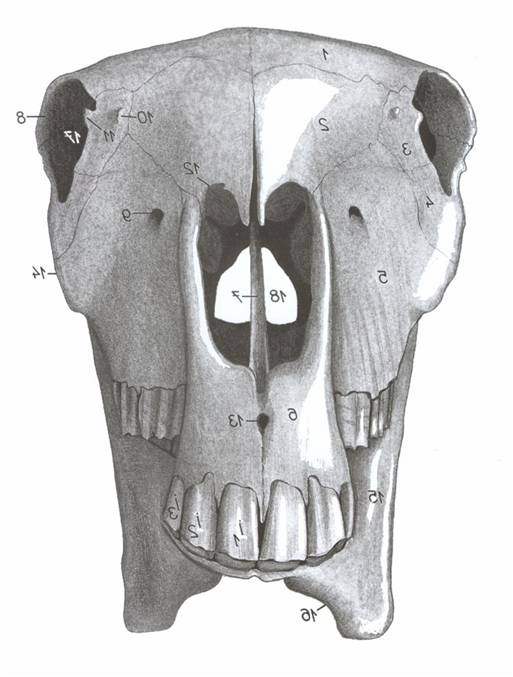
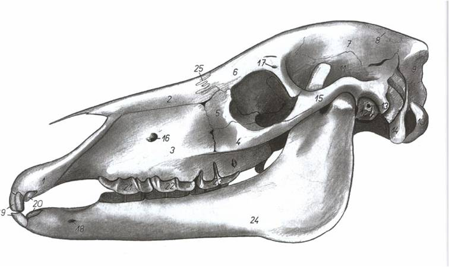
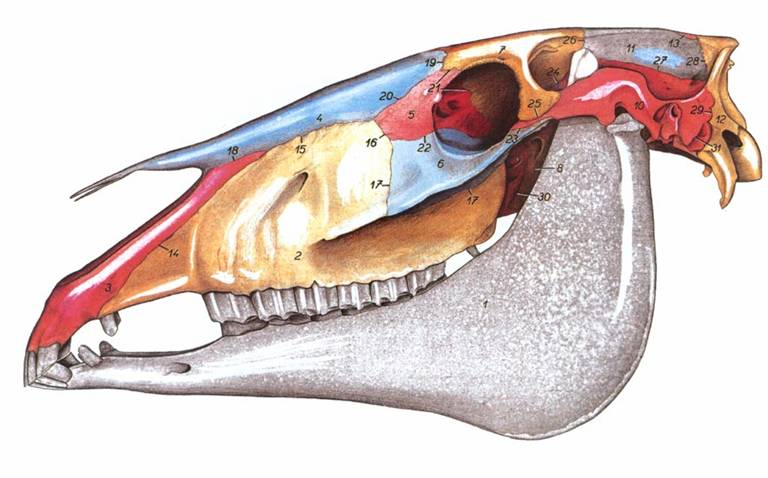
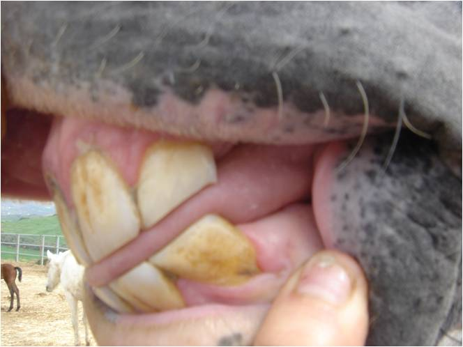
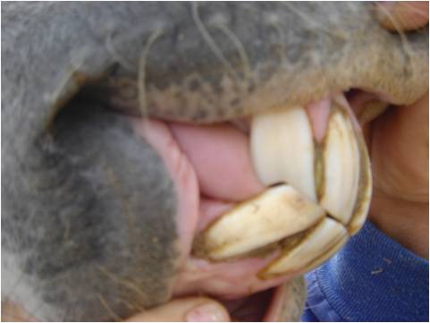
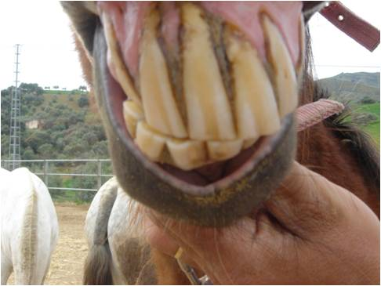

Los dientes son una parte fundamental del aparato digestivo del caballo, permiten la masticación, pero no sólo esto, también nos dan una pista sobre la edad aproximada del animal según su erupción y desgaste.

Para realizar una lectura de la edad del caballo según la dentición es importante conocer los conceptos básicos sobre la dentición del caballo. Como el resto de los animales tienen cuatro tipos de dientes incisivos, caninos (que pueden estar o no), premolares y molares. La fórmula dentaria nos indica la cantidad de cada una de estas piezas que tiene el animal, se apunta el tipo de diente y dos numeros separados por una barra. En el caso del caballo:

**Fórmula dentaria:** Incisivos 3/3 Caninos 1/1 Premolares 3/3 Molares 3/3

El primer número indica la cantidad en la arcada superior o maxilar y el segundo en la arcada inferior o mandibular. La fórmula se refiere a la mitad de los dientes, por lo que para saber el número total, sólo habría que sumarlos todos y multiplicarlos por dos. Además para referirnos a una pieza dentaria en concreto le daremos una letra I para incisivo, C para canino, PM para premolares y M para molares y un número que nos dice su posición contando desde el centro hacia el exterior, también debemos decir si es izquierdo o derecho y superior o inferior.

Por ejemplo, I3 izquierdo superior, se refiere al incisivo más externo de la arcada superior y la mitad izquierda.

**¿Qué son los dientes de lobo?** Se producen cuando también erupciona el 1er premolar, no suele tener raiz y produce roces en la encía porque no tiene diente correspondiente en la arcada contraria.

## Dentición de leche

Al igual que las personas, los caballos también tienen dientes de leche o dentición decidua, que luego mudarán en una permanente. Viendo los momentos en que erupcionan los dientes, podemos saber la edad de un potro.

- I1: 1 ó 2 semanas
- I2: 4-6 semanas
- I3: 6-9 meses
- PM2: 2 semanas
- PM3: 2 semanas
- PM4: 2 semanas
- No tienen molares

## Dentición permanente

La dentición de leche caerá y dejará el espacio para que emerjan la dentición permanente. Esto sucede en momentos determinados y nos dice la edad del caballo. Veremos el hueco dejado por el diente de leche y el nuevo diente saliendo.

- I1: 2-2'5 años
- I2: 3-3'5 años
- I3: 4-4'5 años
- PM2: 2'5 años
- PM3: 3 años
- PM4: 4 años
- M1: 1 año
- M2: 2 años
- M3: 3 años

## ¿Qué hay que mirar para determinar la edad?

1. Erupción dentaria
2. Desgaste
3. Otras particularidades

**PROBLEMA:** El desgaste es poco fiable porque la alimentación es diferente y no se desgastan los dientes igual y además hoy en día se arreglan las bocas y pudiera no coincidir.

**Erupción dentaria:** Normalmente sólo tenemos acceso a los incisivos, si tuviéramos un abrebocas tendríamos una información mucho más completa. En cada edad indicada vemos cómo falta esa pieza y está saliendo la nueva. La diferencia entre los incisivos de leche y los definitivos es que los primeros son redondeados y los segundos rectangulares.

- 2'5 años: Cambiando I1 superior
- 3 años: Cambiando I1 inferior
- 3'5 años: Cambiando I2 superior
- 4 años: Cambiando I2 inferior
- 4'5 años: Cambiando I3 superior
- 5 años: Cambiando I3 inferior: La boca está "CERRADA"

## Particularidades

1. **Pico de Gavilán:** Aparece en I3 a los 7 años y desaparece rápidamente para volver a aparecer a a los 12 ó 13 años definitivamente.
2. **Surco de Galvaine:** Se encuentra en los incisivos.
   - Comienza a aparecer a los 10 años.
   - Avanza conforme crece el diente.
   - Con 15 años llega a mitad del diente.
   - Con 20 años ocupa casi la totalidad del diente y comienza a descender.

