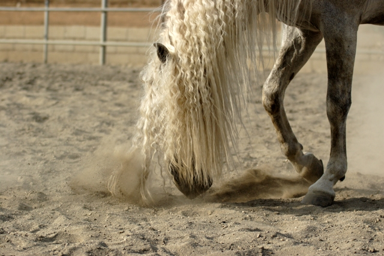
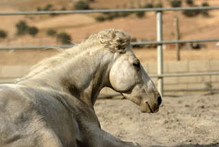

Todos nos hemos enfrentado alguna vez a un caballo con cólico, por eso es importante conocer sus síntomas para poder evaluar su gravedad y reaccionar a tiempo. Lo primero que es necesario saber, un cólico no es una patología de por sí solo, un cólico es la manera que tenemos de determinar en los caballos el dolor abdominal. Este dolor puede estar luego relacionado con distintas patología intestinales (impactaciones, desplazamientos, torsiones...) o de otro origen (estomacales, hepáticas, renales...).

Un caballo que sufre un cólico puede comportarse de distintas maneras y no sólo depende de la intensidad del dolor, si no también de la personalidad del caballo. Caballos muy estoicos son tolerantes al dolor y pueden mostrar signos menos llamativos ante un cólico grave, sin embargo caballos muy sensibles pueden presentar un cuadro de dolor abdominal fuerte ante cólicos de moderada gravedad. Debemos de intentar diferenciar si nos encontramos ante un caballo sin dolor, con dolor leve, moderado, intenso o depresivo. Describiremos un poco más en profundidad cómo se comportan los caballos ante cada tipo de dolor.

## Caballo con dolor leve

- Escarba un poco en el suelo
- Se tumba durante más tiempo del habitual
- Se mira los flancos y/o se estira
- No come y/o juega con el agua
- Se apoya en las paredes

## Caballo con dolor moderado

- Está inquieto y escarba en el suelo
- Se mantiene echado y se revuelca
- Gime
- Se mira los flancos y se cocea la barriga
- Adopta posiciones atípicas (perro sentado o acuclillado)

## Caballo con dolor intenso

- Se revuelca con violencia
- Inquietud extrema
- Suda
- Se cae al suelo
- Otros signos anteriormente nombrados

La depresión puede ser un signo temprano de ciertas enfermedades intestinales o se presenta después de presentar signos de dolor intenso. Por eso cuando nos encontramos a un caballo depresivo es importante observarlo detenidamente y ver si tiene abrasiones cutáneas o se ha golpeado en la cabeza, los costados...

Debemos ser muy observadores y dar a nuestro veterinario todos los detalles posibles a la hora de describir los problemas de nuestro caballo.
