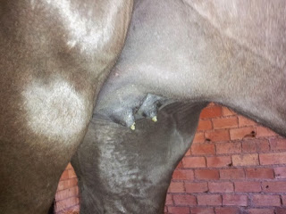
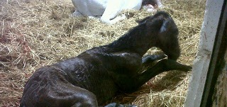
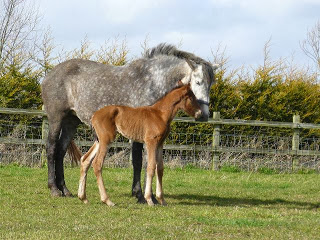

Señores y señoras... se acerca la época de los partos!!! De cara a los nuevos bebes y el momento decisivo, no olvidemos:

- El sitio para el parto, debe estar limpio y seco y tener amplitud. Un corral muy limpio es ideal. Recordad que es un recién nacido! Necesita toda la protección del mundo.

- Los "tapones de cera" aparecerán en los pezones de las ubres de la yegua entre 1-4 días antes del parto, estad atentos!
- Muy importante... no manipular el potro cuando esta saliendo!!!! Cuando vemos saliendo las manitas de nuestro potro nos entra la impaciencia, pero es importante no tirar si no se sabe hacerlo bien y se tiene experiencia- Tranquilo, las yeguas son animales que no suelen tener complicaciones en el parto y en la mayoría de los casos transcurrirá todo sin incidencias.
- Este es el timing normal de un parto de yegua.

1. Una vez empiezan las contracciones el potro estará fuera en 45 minutos.
2. El potro tarda en levantarse 1-2 horas y en mamar 1'5-3 horas
3. La placenta debe caer sola (NUNCA, bajo ninguna circunstancia, tirar) en menos de 4 horas.

Si algo de esto no sucede... llama rápido a tu veterinario!!!! Porque:

1. Si el potro no sale en menos de 1 hora se asfixiara en el canal del parto y podría tratarse de una distocia.
2. Si el potro no se encalostra en las 6-12 horas que siguen al parto no adquirira las inmunoglobulinas que necesita para que sus defensas funcionen y necesitará una transfusión de plasma.
3. Si la yegua no tira la placenta en menos de 5-6 horas contraerá una endometritis infecciosa que puede desembocar en septicemias, laminitis... y va a necesitar tratamiento intensivo y rápido.

Ante las más mínima duda contacta con tu veterinario, él/ella te asesorarán sobre qué hacer.

