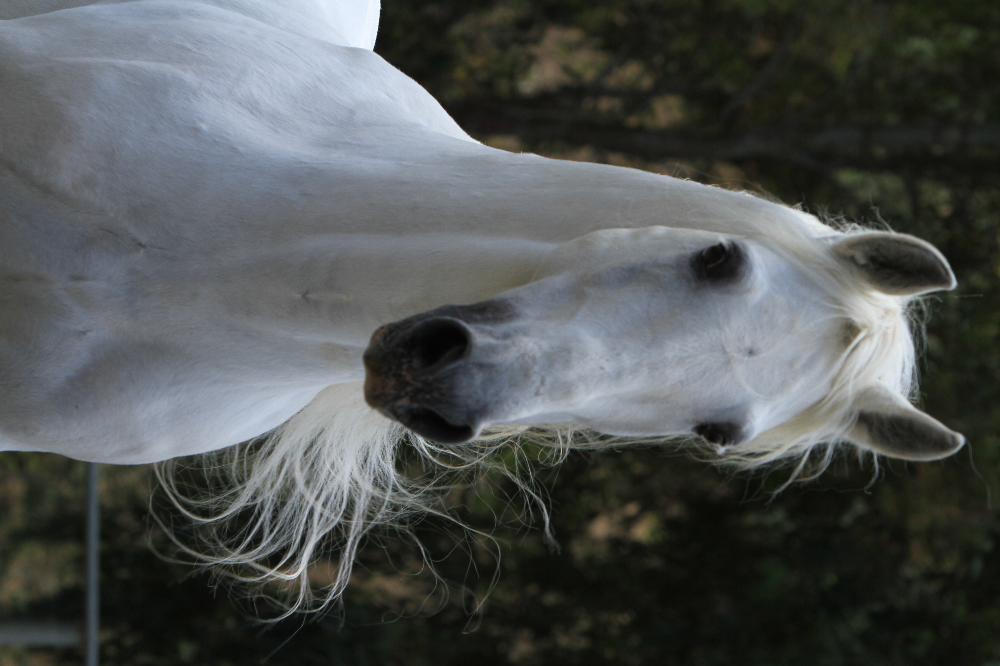
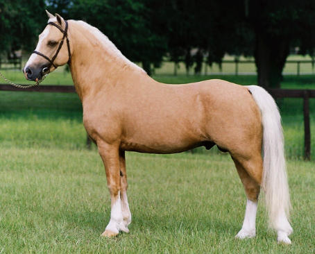
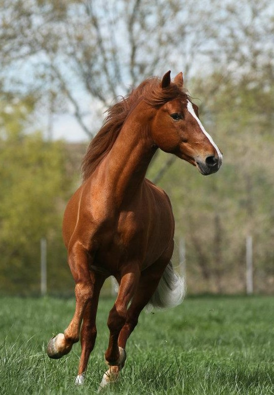

En la actualidad cada vez es más la información de que disponemos de nuestros caballos. El análisis de ADN nos ha permitido conocer los genes que determinan las capas ("colores") de nuestros caballos y poder hacer una predicción de la posible capa que tendrá una descendencia de un determinado cruce entre una yegua y un caballo. A veces puede parecernos complicado de entender pero en realidad es bastante simple.

La mayoría de las capas de los caballos vienen determinadas por cuatro genes y cada gen lo componen dos alelos:

**1. Gen Grey:** El gen que determina la capa torda, es dominante sobre todos los demás. El alelo G determina que el caballo es tordo y el g que no lo es. Tendremos presencia de dos alelos por lo que un caballo puede ser GG, Gg o gg, al ser G dominante siempre que esté (GG o Gg) el caballo será tordo independientemente del resto de los tres genes.

Posibles capas:
- GG y Gg: Torda
- gg: Cualquier otra

Hasta aqui todo es claro y fácil, pero ahora viene la parte complicada, el resto de capas. Tenemos otros tres genes:

<!-- En el original aquí había una foto con pie «Capa negra» que ya no carga en Wix. -->

**2. Gen Extension:** negro EE, Ee o ee (E presencia de eumelanina, pigmentación negra y e ausencia de pigmentación negra)

**3. Gen Agouti:** AA, Aa o aa (Agouti o de Acumulación parcial del pigmento). La presencia de este gen determina la acumulación parcial (en cola, crin y patas) del pigmento negro (en caso de que el alelo E esté presente), el resto del cuerpo será rojo.

**4. Gen Crema:** CC, CCr, CrCr. Determinan la dilución o no de las capas anteriores y darán lugar a capas diluidas como bayo, perla, palomino, negro cenizo o crema cenizo. Un segundo gen que diluye, pero del que todavía no disponemos de un análisis de laboratorio es el DUN (Dd). Se sabe que este gen diluye tanto los colores rojos como los negros, a diferencia del gen CREMA que no diluye el negro cuando solo está presente con una sola dosis.

Existen otras diluciones que pueden implicar a otros genes (Champagne) de los que todavía no conocemos su composición molecular. En algunas ocasiones los resultados de laboratorio, junto con una imagen del animal, nos puede permitir deducir cual es el origen de la dilución que se aprecia en el animal y, por lo tanto, indicar con una cierta probabilidad que genes pueden estar implicados en la capa.

Expliquemolos con ejemplos para aclarar. Primero miraremos el Gen Tordo: gg (por lo que no será tordo)

Un caballo EE o Ee tiene pigmentación negra por lo que puede ser Negro o Castaño y un caballo ee será siempre alazano (no hay pigmento negro)

| Genotipo | Capa |
|---|---|
| gg, ee, --, -- | Alazano |
| gg, EE/Ee, --, -- | Castaño o Negro |

¿Qué nos dice si es castaño o negro? El factor de acumulación parcial del pigmento, si hay, al haber un acúmulo del negro en crin, cola y patas y no estar presente en el resto del cuerpo, será castaño, y si no lo hay será negro. En el caso de los alazanes, sea cual sea el factor de acumulación del pigmento, no tendrá efecto alguno, porque no hay pigmento negro.

| Genotipo | Capa |
|---|---|
| gg, ee, AA/Aa/aa, -- | Alazano |
| gg, EE/Ee, AA/Aa, -- | Castaño |
| gg, EE/Ee, aa, -- | Negro |

¿Y el factor de dilución? Como su propio nombre indica dará lugar a las capas diluidas. Ausencia de dilucion: CC (por lo que permanecerán castaños, negros o alazanos). Dilución de las capas: CCr o CrCr.

Las capas alazanas darán lugar a Palominos y Cremellos (que no tienen pigmentos oscuros en la crin y cola), las capas castañas darán lugar a bayos y perlas (con pigmentaciones oscuras en la crin y cola) y las capas negras darán lugar a negro cenizo y crema cenizo (que son capas uniformes).

**Capas diluidas:**

| Genotipo | Capa |
|---|---|
| gg, ee, AA/Aa/aa, CCr | Palomino |
| gg, ee, AA/Aa/aa, CrCr | Cremello |
| gg, EE/Ee, AA/Aa, CCr | Bayo |
| gg, EE/Ee, AA/Aa, CrCr | Perla |
| gg, EE/Ee, aa, CCr | Negro ceniza (Smokey Black) |
| gg, EE/Ee, aa, CrCr | Crema ceniza (Smokey Cream) |

## Predicción de capas de la descendencia

Al conocer el código genético que determina la capa de dos individuos en concreto podremos establecer las capas de su posible descendencia. Tengamos en cuenta de que cada individuo aporta la "mitad de sus genes" a la hora de reproducirse (un alelo de cada gen) y pueden darse todas las combinaciones posibles. Veámoslo con un ejemplo:

### Ejemplo 1

- **Semental gg, EE, Aa, CCr.** Mirando lo anterior este caballo no es tordo (gg), tiene pigmentos negros (EE), pigmentación negra centrada en crin, cola y patas (Aa) y es de capa diluida (CCr): Por lo que manifestará capa Baya
- **Yegua GG, ee, aa, CC.** Presenta gen tordo (GG) por lo que, sean como sean el resto de los genes, es Torda.

¿De qué capa será un potro de estos dos ejemplares?

- Genes que puede transmitir el semental: g,E,A,C · g,E,a,C · g,E,A,Cr · g,E,a,Cr
- Genes que puede transmitir la yegua: G,e,a,C

¿Cuáles son las posibles combinaciones genéticas y capas que manifestaría este de este potro? Tomaremos un alelo del padre y otro de la madre y haremos combinaciones:

- Gg,Ee,Aa,CC Tordo
- Gg,Ee,aa,CC Tordo
- Gg,Ee,Aa,CCr Tordo
- Gg,Ee,aa,CCr Tordo

Por lo que este cruce tiene un 100% de posibilidades de producir una cría torda.

### Ejemplo 2

- **Semental Gg,ee,Aa,CrCr:** Presenta un alelo G por lo que será tordo
- **Yegua gg,ee,Aa,CCr:** No es torda (gg), no presenta pigmento negro (ee), presenta acúmulo parcial del pigmento negro (Aa) (pero esto no nos influye al no tener pigmento negro) y gen de dilución crema (CrCr). Es de capa Cremella

<!-- [sic] El genotipo de la yegua dice CCr pero el texto dice CrCr y "Cremella"; revisar con Aída. -->

- Genes que puede transmitir el semental: G,e,A,Cr · G,e,a,Cr · g,e,A,Cr · g,e,a,Cr
- Genes que puede transmitis la yegua: g,e,A,C · g,e,A,Cr · g,e,a,C · g,e,a,Cr

¿Cuáles son las posibles combinaciones genéticas y capas que manifestaría este de este potro? Tomaremos un alelo del padre y otro de la madre y haremos combinaciones:

- Gg,ee,AA,CCr Tordo
- Gg,ee,AA,CrCr Tordo
- Gg,ee,Aa,CCr Tordo
- Gg,ee,Aa,CrCr Tordo
- Gg,ee,Aa,CCr Tordo
- Gg,ee,Aa,CrCr Tordo
- Gg,ee,aa,CCr Tordo
- Gg,ee,aa,CrCr Tordo
- gg,ee,Aa,CCr Palomino
- gg,ee,AA,CrCr Cremello
- gg,ee,Aa,CCr Palomino
- gg,ee,Aa,CrCr Cremello
- gg,ee,Aa,CCr Palomino
- gg,ee,Aa,CrCr Cremello
- gg,ee,aa,CCr Palomino
- gg,ee,aa,CrCr Cremello

Así que este cruce tiene un 50% de posibilidades de producir un potro tordo, un 25% de posibilidades de producir un potro palomino y un 25% de posibilidades de producir un potro cremello.

Podemos hacer así un análisis de probabilidades de producir una capa en concreto en nuestra descendencia, cosa que, en algunos casos, determinará los ejemplares a cruzar en función de la capa deseada en su descendencia.

*Photocredit: ¡Gracias Elise por todas estas fantásticas fotos! Thanks to Elise Genest for all these fantastic photos! www.elisegenest.com*
