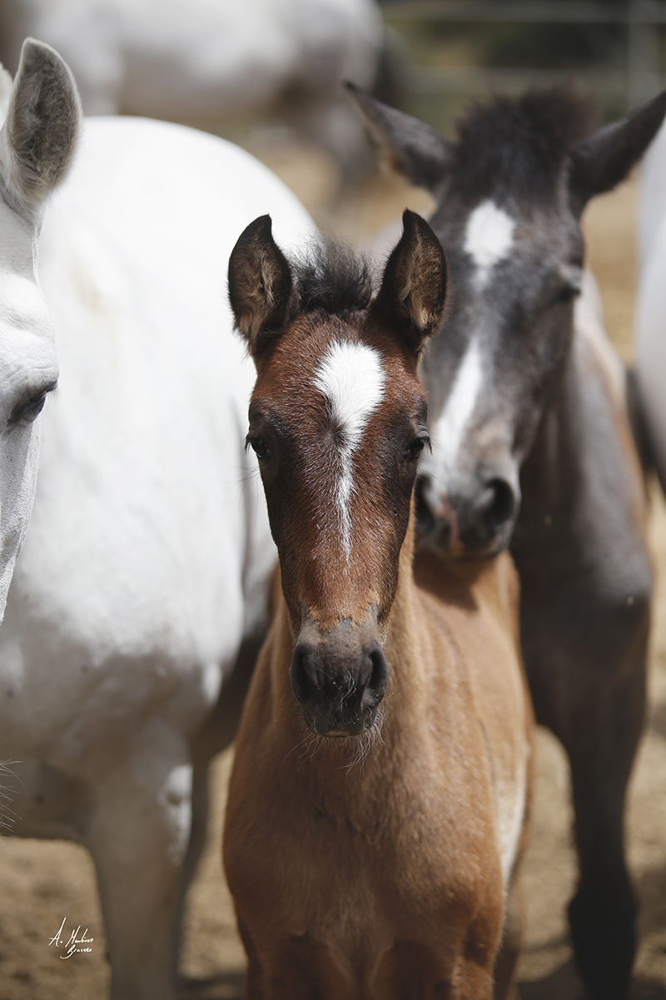
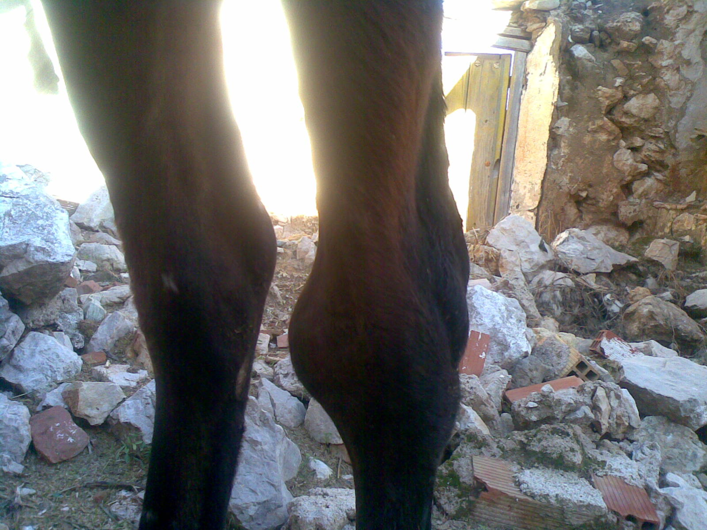

Rhodococcus equi es un microorganismo productor de zoonosis, causante de neumonía granulomatosa y absceso de pulmón en los potros con menos de seis meses de edad. Rhodococcus equi es un patógeno ambiental con distribución universal que se encuentra en el aire, el agua y la tierra. El contacto directo con los animales, sus excrementos y con el estiércol puede ser el origen de la infección, siendo la inhalación el mecanismo de transmisión más probable, aunque también es posible adquirirlo por inoculación a través de la piel, membranas mucosas e ingestión oral. R. equi se presenta en el suelo y pastos de la mayoría de todas las granjas equinas, aunque la incidencia de la enfermedad clínica en las granjas tiene una gran variación. Es probable que esto sea el resultado de las diferentes concentraciones de la bacteria en el suelo, virulencia del organismo y factores de manejo.

Es una patología muy contagiosa y peligrosa para la vida del potro por lo que es conveniente avisar al veterinario a la mayor brevedad si se detectan potros con signos de infeccion por R. equi. La prevención también es de suma importancia para evitar este tipo de patología.

## Signos clínicos

La manifestación clínica más frecuente de infección por R. equi en potrillos es una bronconeumonía supurativa crónica con gran número de abcesos. La difusión lenta de la infección pulmonar sumada a la habilidad destacable en los potrillos de compensar la pérdida de capacidad pulmonar progresiva, hacen difícil el diagnóstico clínico precoz de esta afección.

Primeros signos clínicos son la fiebre moderada y un aumento de la frecuencia respiratoria, solamente detectable, cuando los potrillos corren haciendo ejercicio, o estan nerviosos por el manejo al que están sometidos. Signos Avanzados de Neumonía incluyen: pérdida de apetito, letargia, fiebre, aumento de la frecuencia respiratoria y esfuerzo respiratorio caracterizado por apertura de los ollares y presencia de participación abdominal en la respiración. La tos y descarga nasal bilateral no están siempre presentes. Un pequeño porcentaje de potrillos afectados puede presentar una forma subaguda que es más desvastadora. Estos potrillos pueden encontrarse muertos o con fallo respiratorio agudo, con fiebre alta y sin previa presentación de signos de enfermedad respiratoria.

### Otros signos que pueden presentarse

Abscesos abdominales grandes, con extensas adherencias al aparato gastrointestinal y otras vísceras abdominales. Estos potrillos pueden presentarse a la primera consulta por cólico y/o pérdida de peso. El pronóstico para la recuperación de los abscesos abdominales debido a R. equi es malo, aun con antimicrobianos y terapia de sostén amplia. Secuelas inmunomediadas de la infección por R. equi como es la distensión sinovial de múltiples articulaciones debido a sinovitis por complejos inmunes. Los potrillos con sinovitis por complejos inmunes pueden estar rígidos, pero rara vez muestran cojera.

## Diagnóstico

Suele hacerse un diagnóstico presuntivo basado en:

- Cuadro clínico
- Cultivo bacteriano (según la situación inmunológica, la procedencia de la muestra, el tiempo necesario para el crecimiento, la morfología de la colonia y las características fenotípicas de la cepa)
- Hematología y bioquímica sanguínea: Los parámetros clínicos compatibles con infección por R. equi incluyen hiperfibrinogenemia, leucocitosis y trombocitosis
- Radiología
- Ecografía

## Prevención

Hay un crecimiento progresivo de infección en aquellas ganaderias con una larga historia en la cría de caballos, de manera que aquellos que han sido usados por muchos años en la cría, presentan una infección enzoótica, asociada con la alta población de yeguas y de potrillos y con características especiales del suelo (arenoso y polvoriento). Los potrillos mantenidos en corrales sobrecargados de materia fecal, con mucho polvo, constituyen un gran desafío al mantener a la bacteria en forma virulenta y favorecer la presentación clínica de la enfermedad. Los corrales deben rotarse para disminuir la concentración de R. equi, eliminando la posibilidad de inhalación del organismo. El terreno seco y arenoso debe ser cultivado y el sistema de riego debe utilizarse antes de permitir el acceso a los potrillos, disminuyendo el polvo. El diagnóstico precoz de los casos de R. equi, el aislamiento y tratamiento de los potrillos infectados, reduce la contaminación de cepas virulentas y disminuye los costos de la terapia.
