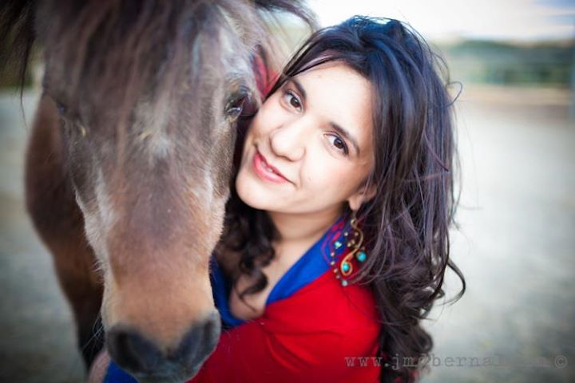
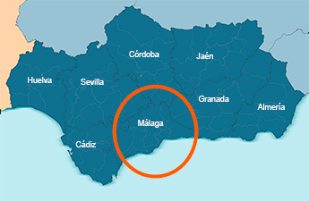

<!-- Texto copiado tal cual de la web de Wix el 12/10/2026 (erratas incluidas, marcadas con [sic]). -->

# VETEQUUS

## Servicios veterinarios

Tenemos la fortuna de haber hecho de nuestra pasión, los caballos, nuestra profesión. En Vetequus entiendemos [sic] lo mucho que ama a su caballo y hemos trabajado mucho para procurar la salud y seguridad de los animales desde 2005. Ofrecemos servicios de alta calidad en un entorno cálido y amigable. En Vetequus nos adherimos a los más altos estándares para todos los servicios que ofrecemos. Nuestro único objetivo es asegurarnos de que su caballo se mantenga sano, atlético y feliz.

## Los servicios que ofrecemos

**El mejor cuidado posible.** No solo el mejor cuidado, sino cariño para su caballo. Llámenos hoy mismo.

Botones: «Contáctenos» (mailto:vetequus@gmail.com) · «Teféfono» [sic] (tel:669937061)

### Medicina general
La base de la veterinaria equina es la medicina general. Estamos disponibles para cualquier consulta y sobre todo las relacionadas con la medicina interna. Ya sean problemas digestivos, respiratorios, dermatológicos o de cualquier otro tipo no dude en ponerse en contacto con nosotros para concertar una cita y realizar un estudio detallado de cualquier problema que ataña a nuestro caballo.

### Medicina deportiva
Cada día la exigencia de rendimiento de nuestros caballos es más alta, para ello deben de contar con ayuda del veterinario que les ayude a mostrar su máximo potencial. Ofrecemos servicios de diagnóstico de cojeras, ecografía, radiología digital y diagnóstico de problemas de rendimiento.

### Reproducción asistida y neonatología
Ofertamos amplios servicios de ginecología, andrología y obstetricia. A parte de servicios de diagnóstico y control de gestación, diagnóstico de problemas ginecológicos e inseminación artificial, hemos incorporado a nuestros servicios la extracción, valoración, refrigeración y comercialización de semen refrigerado y transplante embrionarios.

### Odontología
Incluso si su caballo está sano, los Servicios de cuidado dental para équidos son esenciales. Si se detectan a tiempo, hay problemas que se pueden resolver de manera rápida y económica. Por eso es que en Vetequus estamos comprometidos con el cuidado preventivo. Contáctenos para saber más sobre nuestros servicios y sobre cómo puede ayudar a hacer una diferencia en las vidas de las caballos.

### Diagnóstico por imagen
La radiología digital y la ecografía nos permiten abordar de manera completa diversas patologías para su diagnóstico y tratamiento. El diagnóstico de cojeras, el control y seguimiento de patologías del aparato locomotor, evaluación de infosuras/laminitis, cuidados ortopédicos, evaluación reproductiva... nos piden estar cada día más avanzado en este campo.

### Exámenes precompra
El examen precompra permite conocer la salud actual del caballo para su valoración por parte de vendedor y comprador. Todo buen examen veterinario de compra venta debe incluir pruebas que evalúen el caballo tanto en estático (valoraciones de aparato digestivo, respiratorio, cutáneo, oftalmológicas, odontológicas, palpación y valoración de miembros, dorso y cuello) como en movimiento (pruebas de flexión, valoración de cojeras, pruebas de esfuerzo). Esto debe ir apoyado por un buen reconocimiento radiológico y pruebas laboratoriales ante cualquier sospecha y exámenes reproductivos en animales que se dedicarán a la cría. Ante los resultados el comprador podrá tener una visión completa del caballo y tomar una decisión con todas las garantías de salud.

### Medicina preventiva
Asesoramiento para la prevención de todo tipo de enfermedades. Establecimiento de programas de vacunación y desparasitación para evitar las enfermedades infecciosas más frecuentes en el caballo (influenza, tétanos, fiebre del nilo WNV...). Establecimiento de medidas nutricionales, odontológicas y de manejo para prevenir la aparición de problemas digestivos (cólicos), respiratorios, alérgicos... La prevención es la mejor herramienta para ahorrar dinero y salvaguardar la salud de nuestros animales.

### Identificación equina y gestión de documentos
Elaboración de reseñas, implantación de microchip y gestión de los trámites para elaborar el pasaporte/DIE, cambios de propietario, gestión de documentación para transporte de équidos, libros de explotación...
Tenemos la mejor relación con todas las administraciones y las asociaciones de ganaderos para facilitar y agilizar todas sus gestiones.

## Sobre mí

*Pie de foto original: «Coquito y yo!!! Es más guapo mi viejito!»*

Aída Huertas Dominguez, licenciada en Veterinaria por la Universidad de Córdoba en el año 2003 y colegiada 291102 del Colegio de Veterinarios de Málaga. Pertenezco a la primera promoción española que accedió al Certificado Español en Clínica Equina en el año 2019.

Nací en la cuna de una familia que se ha dedicado con pasión a la cría de caballos los que me facilitó el acceso a los conocimientos para la cría, mejora y selección de ganado equino. Durante mis estudios universitarios se confirmó mi afición y dedicación al mundo del caballo siendo alumna interna de diversas áreas como Etnología, Etología y Radiología así como Alumna Interna del Hospital Clínico Veterinario de la Universidad de Córdoba. Asimismo durante los veranos y otras vacaciones realicé prácticas en varios hospitales europeos, como el Hospital Equinia (Noorderwijk, Bélgica).

Una vez concluidos mis estudios universitarios decidí ampliar sus [sic] conocimientos en veterinaria equina y realicé el internado de Centro Policlínico Veterinario San Vicente del Raspeig bajo la supervisión del Dr. Manuel Alejandro Rodriguez donde completé su [sic] formación de reproducción equina, clínica ambulante, cuidados intensivos y cirugía. Más tarde realicé estancias en los más prestigiosos hospitales europeos como el Hospital Clínico Veterinario de la Universidad Autónoma de Barcelona, Hospital De Morette (Bélgica), Animal Health Trust (Reino Unido), Three Counties Equine Hospital (UK)…

Tras esta intensa formación teórica y práctica en 2006 decidí comenzar a trabajar de forma autónoma en forma de Clínica Ambulante Equina “Vet- Equus Servicios Veterinarios”. Desde entonces he estado ofreciendo mis servicios como veterinaria sin descuidar la formación continua realizando un postgrado de Medicina Interna Equina por la UAB, un MBA por la Escuela de Negocios de ESIC y acudiendo a diversos congresos y cursos prácticos.

Siempre con ilusión, cariño y ganas de seguir aprendiendo.

## Horario de servicio

Llámanos y concierta tu cita

- Lunes - Viernes: 10 a. m. - 6 p. m.
- Sábado, Domingos y Festivos: Sólo urgencias

Botones: «Teléfono» (tel:669937061) · «Contacto» (mailto:vetequus@gmail.com)

## Áreas de trabajo

Les atenderemos en la provincia de Málaga y zonas colindantes, pero podemos estudiar consultas en otras zonas. Para más información no dudes en contactarnos.

Botón: «Contactar» (tel:669937061)

## Contáctenos (formulario)

Campos: nombre, dirección, email, teléfono, asunto, mensaje («Type your message here...» [en inglés]). Botón «Submit» [en inglés].

## Pie de página

- Formulario de suscripción (solo email) · botón «Enviar»
- Teléfono: 669 937 061
- Facebook: https://www.facebook.com/vetequus
- Instagram: https://www.instagram.com/aidahuertas/
- «©2019 by Vetequus. Proudly created with Wix.com»
- Widgets incrustados de Wix: últimas entradas del blog y feed de Instagram
